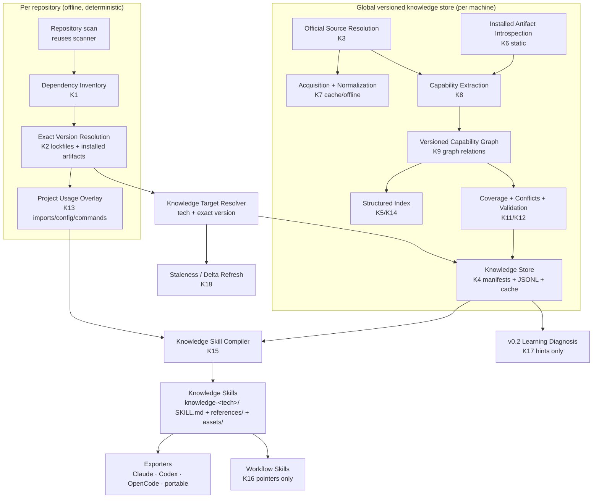

# SkillForge v0.3 — Versioned Library Intelligence

> Status: **implementation in progress**. The user authorized proceeding through
> the full plan (`/goal ทำตาม plan ให้หมด`), using recommended defaults for
> remaining §33 decisions. Release approval is not implied by intermediate tests.
> This document plans the next capability on top of the *actual* repository
> state (v0.2 in the working tree). It is grounded in a full audit, not in the
> intended architecture of the specification.
>
> Core principle:
>
> **Know everything that can be proven about the exact technology versions a
> project uses, load only what the current task needs, and never invent what
> cannot be proven.**

## Implementation status

| Milestone | Status | Notes |
| --- | --- | --- |
| K0 — v0.2 baseline stabilization | **done** | release `0.2.0`: suite green (560 passed at K2 close), docs (`learning.md`, `execution-security.md`, README, CHANGELOG), version bump, redaction/process/readiness/upgrade bug fixes, manual end-to-end smoke |
| K1 — Deep dependency inventory | **done** | `models/knowledge.py`, `knowledge/inventory.py`, `[knowledge]` config section, 29 unit tests; no CLI yet (planned in §28) |
| K2 — Exact version resolution | **done** | opt-in `ScanOptions.read_lockfiles` (+ `knowledge.max_lockfile_bytes`), `knowledge/lockfiles/` (12 formats across pypi/npm/go/nuget/pub/maven), `knowledge/versions.py` (`packaging` for PEP 440; semver/NuGet/Maven parsers), `knowledge/artifacts.py` (in-repo Python venv + Node `node_modules`, symlink-safe), `knowledge/resolution.py` (ladder, `KnowledgeConflict`, transitive entries). Deliberate v1 scope: global caches (`NUGET_PACKAGES`, `GOMODCACHE`, `PUB_CACHE`, `~/.m2`) are **not** searched — unresolved wins over borrowing a version from an unrelated environment; revisit with explicit consent in a later milestone |
| K3 — Official source resolution | **done** | `knowledge/authority.py` + versioned `knowledge/data/authority.toml` (21 curated packages: official hosts, repository/tag templates, versioned docs/api templates; spoof/community/private-host/HTTP rejections with reasons), `knowledge/sources.py` (offline `SourceResolver` per ecosystem; candidates from the curated map, installed-artifact declarations, and **injected registry snapshots**; `KnowledgeSource` accepted+rejected with `VersionMatchKind`). Additive enum value `REJECTED_INSECURE_SCHEME` for the HTTPS guard. Network fetching stays out of K3 (snapshots only); consent + `httpx` extra remain for K7 (§33 #3, #15) |
| K4 — Global versioned knowledge store | **done** | `knowledge/store.py` (platform data dir per §33 #4 + `SKILLFORGE_KNOWLEDGE_HOME`; layout §13; atomic writes, bounded locks with stale-writer recovery, hash verification, `.corrupt-<ts>` quarantine, content-derived `store_hash` → cross-project reuse, `registry.json`), `knowledge/staleness.py` (`FRESH`/`MISSING`/`HASH_MISMATCH`/`CORRUPT` for `KnowledgeRef`), models `KnowledgeManifest`/`KnowledgeRegistry` + additive `KnowledgeRef` on `SkillManifest`, `sha256_file` in `utils/fs.py`, 14 unit tests. Deferred: `[knowledge].home` config field (env + constructor work now; config needs origin-aware user/repo validation at the CLI milestone) and the `index/`/`cache/` directories (K5/K7) |
| K5 — Capability IR + structured index | **done** | `models/knowledge.py` capability IR (`Capability`, `CapabilityKind` ×18, `CapabilityDomain`, `CapabilityParameter`, `CapabilitySignature`, `CapabilityRelationship`, `VersionLifecycle`), `knowledge/taxonomy.py` (10 curated domains + keyword detection + camel/snake/kebab tokenizer), `knowledge/capabilities.py` (stable ids, sorted/deduped normalization, counts), `knowledge/index.py` (`by-name`/`by-kind`/`by-domain`/`by-parent`/`postings` payloads with per-token caps, atomic writers, lazy `KnowledgeIndex` with deterministic ranking and all §14 filters), 14 unit tests incl. 10k-capability index + lookup well under 5 s |
| K6 — Installed artifact / API introspection | **implemented v1** | Static Python AST/stubs, custom Node declarations, .NET XML docs, Go/Dart source heuristics, Java JAR class names. Added budgets, confined locators, non-symlink traversal, evidence hashes, native-only UNKNOWN diagnostics, and draft-to-IR conversion. Partial Python stubs no longer hide source-only modules. Regex-derived surfaces are not advertised as complete public API. Synthetic fixture acceptance passes; whole-artifact parse-result caching and broader installed locators remain integration work. |
| K7 — Documentation acquisition + normalization | **implemented core** | Default offline; repo configs cannot set network consent; optional `[knowledge]` httpx adapter pins public DNS results and TLS server name, disables proxies, bounds bytes, rechecks redirects, respects robots, and paces requests. Hash-checked offline cache + ETag/Last-Modified revalidation; HTML/Markdown/JSON/XML/YAML normalizers and same-host sitemap/llms/API-index URL discovery helper. Sequential worker (≤4). No live fetch performed; discovery orchestration/CLI integration remains for the build workflow. |
| K8 — Capability extraction | **implemented bounded v1** | Proof-required draft merge, artifact signature precedence, signature conflict records, quote limits/redaction, EXACT official-source guards. Documentation extractor accepts explicitly typed API headings only: ordinary examples are not exported API evidence. Other documentation layouts produce coverage gaps, not invented capabilities. |
| K9 — Versioned capability graph | **implemented core** | Deterministic typed edges, hierarchy/domain navigation, unknown-target and duplicate rejection, iterative DAG cycle checks, hash-aware persistence through the store. Related-to edges may be symmetric; hierarchy/extends/requires cycles are rejected. |
| K10–K20 | **pending** | Next: K10 tool intelligence. Remaining lifecycle, coverage, overlay, CLI/build/search, compilation, incremental reuse, validation, exports, security/corpus review and release gates must still be completed. |

### Latest verification (2026-10-17)

- Windows/Python 3.14: `689 passed, 1 skipped` (optional live LLM test has no API key).
- Ruff/type checks and build are rerun at each bounded increment; no Linux result claimed.
- Offline integration test covers artifact → extraction → store → index → graph.
- Additional corrections: preserve callable parameter order; refuse store-key/file traversal;
  verify manifest hashes against registry; reject prerelease/release URL false matches;
  macOS knowledge data uses `~/Library/Application Support/skillforge/knowledge`.
- These are intermediate implementation results, **not completion of the full v0.3 plan**.

## 0. Preconditions discovered by the audit

The current working tree contains the v0.2 implementation, but it is **not a
green, released baseline**:

| Item | Actual state |
| --- | --- |
| Git HEAD | `fdfd7ff` — v0.1 plus release-hygiene commits; v0.2 is **uncommitted** |
| `pyproject.toml` version | `0.1.0` (not bumped) |
| CHANGELOG | no `0.2.0` entry |
| README / docs | no v0.2 sections; `docs/learning.md` and `docs/execution-security.md` missing |
| Test suite | `460 passed, 12 failed, 1 skipped` (`pytest -q`, measured during this audit) |
| `docs/V0_2_IMPLEMENTATION_PLAN.md` | present |

**K0 (baseline stabilization) is therefore a required first milestone before
K1.** The v0.3 plan assumes K0 lands and the suite is green.

---

## 1. Executive summary

v0.1 taught SkillForge to *read* repositories and generate evidence-backed
workflow skills. v0.2 taught it to *execute and verify* workflows safely. v0.3
adds **Versioned Library Intelligence**: a deterministic knowledge compiler
that turns (a) exact resolved dependency versions, (b) installed artifacts and
their static public API metadata, and (c) authoritative, version-matched
official sources into a structured **Versioned Capability Graph** per
technology *version*, stored once globally, overlaid with project usage, and
compiled into progressively-disclosed Agent Skills.

Key properties:

- **Exact versions first.** No knowledge is attached to a version that was
  guessed. Lockfiles and installed artifacts are the primary resolution
  evidence; otherwise the entry stays `UNRESOLVED`.
- **Deterministic extraction first.** Types, metadata, ASTs, and official
  machine-readable references carry authority. An LLM is never the sole
  evidence that a capability exists.
- **Two views, never merged.** The *complete library capability view* (global,
  version-pinned, reusable across projects) is kept separate from the *project
  usage overlay* (which capabilities this repository actually uses, with
  file/line evidence).
- **Honest coverage.** Completeness is measured against authoritative
  denominators where they exist and reported as `UNKNOWN` otherwise. No
  fabricated 100%.
- **Offline stays a first-class mode.** No network is ever required for
  repository analysis, skill generation, learning, validation, export, or for
  using knowledge that is already in the local store.
- **Never execute dependency code.** Introspection is static: metadata, stubs,
  declarations, ASTs, docs. Execution remains exclusively the v0.2 learning
  engine's business, under explicit consent.

---

## 2. Audit of the current architecture (v0.2 working tree)

### 2.1 Packages that exist today

```
src/skillforge/
├── cli/            # Typer app, AppState, ui helpers, commands:
│                   # init, analyze, generate, learn, list, validate, doctor,
│                   # eval, export, clean
├── models/         # pydantic domain models only (no I/O):
│   ├── common.py       # Certainty, Evidence (auto-redacted), RiskLevel, Severity, Unknown
│   ├── repository.py   # RepositoryProfile, Dependency, DetectedTechnology, ProjectComponent…
│   ├── workflow.py     # Command, Workflow, Service, Database, API, Risk
│   ├── skill.py        # SkillBundle, SkillMetadata, SkillFile, SkillManifest, GeneratedSkill
│   ├── learning.py     # v0.2: verification, execution, session, learned-workflow models
│   ├── validation.py   # ValidationFinding/ValidationResult
│   ├── evaluation.py   # MetricValue with measured/NOT_MEASURED semantics
│   └── doctor.py
├── analyzer/       # scanner (ignore rules, budgets, secret exclusion), detectors/, languages
├── discovery/      # command extraction + workflow synthesis
├── context/        # token-budgeted context selection for optional LLM calls
├── planner/        # rule-based skill recommendation
├── generator/      # blueprint, Jinja templates, references, scripts, enrichment
├── skills/         # bundle store: read/write, safe_join, per-file hashes
├── validator/      # check families incl. v0.2 check_verification
├── security/       # secrets, redaction, command_risk, paths, injection, argv
├── providers/      # LLMProvider protocol + registry + http + mock (consent gated)
├── exporters/      # Claude Code / Codex / OpenCode / portable
├── evaluation/     # scenario runner + honest metrics
├── execution/      # v0.2: ExecutionBackend, LocalExecutionBackend, ManagedProcess, readiness
├── learning/       # v0.2: plan, diagnosis, llm_diagnosis, generalize, fingerprint,
│                   # store (.skillforge/sessions), session, upgrade, targets
└── utils/          # fs (atomic writes, sha256_text), git, toml, globs, markdown, subproc, text
```

### 2.2 v0.2 specifics relevant to v0.3

- **Execution engine**: `execution/base.py` (`ExecutionBackend` ABC,
  `ExecutionRequest`, `ExecutionOutcome`, `ManagedProcessLike` protocol),
  `execution/process.py` (bounded pipes, process-group termination),
  `execution/local.py` (argv-only, cwd confinement), `execution/readiness.py`
  (HTTP/TCP/log/process readiness, loopback-only HTTP).
- **Learning engine**: `learning/planning.py` (evidence-backed `ExecutionPlan`),
  `learning/session.py` (`LearningSessionRunner` with bounded retries, cleanup
  in `finally`), `learning/diagnosis.py` (deterministic categories),
  `learning/llm_diagnosis.py` (reuses `LLMProvider` + consent),
  `learning/generalize.py` (LearnedWorkflow + troubleshooting + sanitization),
  `learning/upgrade.py` (in-place skill upgrade), `learning/fingerprint.py`
  (repository fingerprint + staleness), `learning/store.py` (`.skillforge/sessions`).
- **Verification model**: `SkillVerification` in `.skillforge.json`
  (status/method/session/fingerprint); `validator/checks.py::check_verification`
  rejects false `VERIFIED` claims; `skillforge list` computes `STALE`.
- **Security invariants already enforced**: repository configuration cannot
  enable command execution (`security.allow_command_execution = true` is a
  config error); external LLM transmission requires explicit consent; all
  writes go through `safe_join`; `Evidence` snippets are redacted at model
  construction; log records pass a redaction filter.

### 2.3 Constraints discovered that shape the v0.3 design

1. **Lockfile contents are deliberately never retained.**
   `analyzer/scanner.py::_NO_CONTENT_CATEGORIES` includes `FileCategory.LOCKFILE`
   (as well as `LICENSE`, `DATA`, `SECRET`). `FileCategory.LOCKFILE` exists and
   lockfiles are *recorded* but not *read*. Exact version resolution therefore
   requires a **new, opt-in, bounded lockfile read path** — not a scanner
   redesign. `analyze` output must stay byte-compatible for existing tests.
2. **Dependencies are currently declared-only.** Detectors build
   `Dependency(ecosystem, name, version_spec, scope, manifest, certainty,
   evidence)`; the existing `resolved_version` field is **never populated**.
   v0.3 adds a separate inventory layer and must not repurpose v0.1 semantics.
3. **Single walker, single identity.** There is exactly one repository walker
   (`analyzer/scanner.py`), one evidence model (`models/common.py`), one path
   guard (`security/paths.py`), one redaction layer, one provider abstraction.
   v0.3 must reuse all of them and add no parallel versions.
4. **No cache subsystem exists.** v0.2 added content hashing
   (`utils/fs.sha256_text`, `learning/fingerprint.sha256_file`) but no cache
   directory. v0.3 introduces the first cache; it must be content-addressed,
   hash-verified, and atomically written like the rest of the codebase.
5. **No network egress for non-LLM purposes exists yet.** `providers/http.py`
   uses `httpx` lazily behind the `[llm]` extra and a consent gate. v0.3
   introduces a second, separate egress path (official sources) with its own
   consent and transport abstraction.
6. **Config sections are closed.** `config.py::_SECTIONS` is a frozenset of
   `project, analysis, provider, skills, security, export, evaluation`;
   `SecuritySettings` rejects `allow_command_execution = true`. Adding
   `[knowledge]` is additive but must follow the same load precedence and the
   same "repository config cannot grant itself capabilities" rule.
7. **CLI is flat.** `cli/main.py` registers command functions directly on one
   `typer.Typer`. A `knowledge` sub-app is the first sub-typer; `AppState`
   sharing must be handled deliberately.
8. **CI build job asserts asset counts** (`10` skill templates, `6` script
   templates). New Jinja templates for knowledge skills would break it unless
   updated in the same change. The plan therefore renders knowledge references
   in Python (as `generator/references.py` already does) and ships one new
   stdlib script template only if it updates the CI assertion deliberately.
9. **Determinism rules are enforced by tests.** Byte-identical regeneration and
   analysis are asserted; knowledge compilation must produce byte-identical
   output for identical store inputs, with timestamps confined to manifests.
10. **`utils/fs.read_json` is capped at 8 MB** and `Dependency`-bearing
    lockfiles can exceed `analysis.max_file_size = 200_000`. Knowledge lockfile
    reading needs its own caps, not a global relaxation.

---

## 3. Reusable existing components

| Need in v0.3 | Existing component | Reuse decision |
| --- | --- | --- |
| Repository walking | `analyzer/scanner.py` + `analyzer/ignore.py` | Add `ScanOptions.read_lockfiles` (default `False`); no second walker |
| Manifest/dependency discovery | `analyzer/detectors/*` | Keep as the *declared* source; inventory merges on top |
| Evidence + redaction | `models/common.Evidence`, `security/redaction.py` | Every inventory/source/usage claim carries `Evidence` |
| Certainty semantics | `models/common.Certainty` | `FACT` for artifact/lockfile facts, `INFERENCE` for heuristics, `UNKNOWN` for gaps |
| Risk/safety | `security/paths.safe_join`, `is_absolute_local_path` | Cache writes, artifact paths, project overlay paths |
| Secrets | `security/secrets.py` | Scan acquired docs before storage; scan compiled skills |
| Prompt injection | `security/injection.py` | Apply to normalized docs before any LLM summarization |
| LLM providers | `providers/base.py`, `providers/registry.py` | Optional summarization only; same consent path |
| Context budgeting | `context/selector.py` | Bound optional LLM inputs (never whole docs) |
| Skill bundle + store | `models/skill.py`, `skills/store.py` | Knowledge skills are ordinary `SkillBundle`s |
| Generation pattern | `generator/blueprint.py`, `generator/references.py` | Blueprint gains an optional knowledge view; references are rendered in Python |
| Exporters | `exporters/*` | Unchanged; knowledge skills export like any skill |
| Validation | `validator/*` | Reuse `ValidationResult`; add knowledge-specific checks; compile-time knowledge validation is separate but shares codes/severity |
| Config | `config.py` | Add `[knowledge]` section; same precedence; repo config cannot enable network |
| Logging/tracing | `logging.py` | Spans for acquire/parse/extract/index/compile |
| CLI | `cli/common.py`, `cli/state.py` | Same error handling, `emit_json`, exit codes; knowledge sub-app |
| Filesystem safety | `utils/fs.py` | `atomic_write_text`, `read_text_capped`, `sha256_text`; promote `sha256_file` to utils |
| Tool probing | `utils/subproc.probe` | Fixed argv tool version probes only; never dependency code |
| v0.2 fingerprinting/staleness | `learning/fingerprint.py`, `StalenessReport` | Pattern reuse; knowledge gets its own staleness module (no cross-dependency) |
| v0.2 diagnosis | `learning/diagnosis.py`, `Diagnosis` model | Additive `knowledge_hints` field; enrichment only |

**New dependency budget (needs approval, §33):** `packaging` for PEP 440
version math (core); `httpx` behind a new `[knowledge]` extra for acquisition.
No parser frameworks, no graph database, no vector database.

---

## 4. Architecture overview



The deterministic column (everything except optional LLM summarization) is the
product. Every arrow is a Python module with a narrow interface and pydantic
models in `models/knowledge.py`.

---

## 5. Dependency inventory design (K1)

**Goal:** know every technology the project declares or resolves, its
relationship, scope, role, and importance — without duplicating detectors.

**Design**

- `knowledge/inventory.py::build_inventory(profile, scan, settings) -> DependencyInventory`.
- Sources, in priority order for *identity* (not version):
  1. `RepositoryProfile.dependencies` (declared, evidence-backed, per manifest);
  2. `RepositoryProfile.technologies` (frameworks, runtimes, tools, package managers);
  3. commands/CI evidence (tooling used but declared nowhere);
  4. lockfiles (identities + exact versions + transitive closure).
- Classification (new enums; **do not overload v0.1 `DependencyScope`**):
  - `relationship`: `DIRECT | TRANSITIVE | WORKSPACE | UNKNOWN`
  - `scope`: reuse existing `DependencyScope` (runtime/development/optional/peer/unknown)
  - `role`: `FRAMEWORK | LIBRARY | RUNTIME | SDK | UI_COMPONENT_LIBRARY | DATABASE |
    ORM | MIGRATION_TOOL | BUILD_TOOL | TEST_TOOL | LINTER | FORMATTER |
    CONTAINER_TOOL | INFRA_TOOL | CLI_TOOL | CODE_GENERATOR | OBSERVABILITY | OTHER`
  - `importance`: `CRITICAL | HIGH | MEDIUM | LOW | TRANSITIVE` — derived by
    deterministic rules (framework/runtime + direct + used in source = high;
    dev tool used in detected commands = medium; transitive = low) and
    overridable in `[knowledge] priority` config.
- Monorepo awareness: components from `RepositoryProfile.components`; entries
  keyed by `(ecosystem, name, component)`; workspace/package references marked
  `WORKSPACE`.
- Caps: `knowledge.max_inventory_entries` (default 2000) — truncation recorded
  as a warning, never silent. Tooling-only technologies (docker, ruff, pytest)
  are first-class entries with `role=TOOL` even when no package version exists;
  their knowledge comes from CLI/config docs (K10).

**Inputs:** `RepositoryProfile`, `ScanResult` (lockfiles optionally retained),
`Settings`.
**Outputs:** `DependencyInventory` + `Evidence` per entry.
**Security:** lockfile contents are untrusted structured data; parsed without
execution; snippets are never copied into evidence; size-capped.
**Tests:** per-ecosystem inventory fixtures, monorepo case, truncation,
importance rules, no-duplicate-identity, tooling-only technologies.

---

## 6. Exact version resolution design (K2)

**Resolution ladder per entry (first hit wins, recorded):**

1. **Lockfile exact** — `ResolutionMethod.LOCKFILE`, `Certainty.FACT`.
2. **Installed artifact** — `ResolutionMethod.INSTALLED`, `Certainty.FACT`
   (reads metadata only; never imports/executes).
3. **Manifest pin** (exact `==`/`=x.y.z`/`resolved` without range) —
   `MANIFEST_PIN`, `Certainty.FACT`.
4. **Manifest range** — `MANIFEST_RANGE`, `Certainty.INFERENCE`, resolves
   nothing; knowledge target stays unresolved.
5. **Unresolved** — `ResolutionMethod.NONE`, `Certainty.UNKNOWN`.

**Never guess.** If signals disagree (multiple lockfiles, lockfile vs installed),
record `KnowledgeConflict` and keep both claims; do not pick quietly.

**Lockfile readers** (`knowledge/lockfiles/`, registry pattern):

| Ecosystem | Formats | Notes |
| --- | --- | --- |
| Python | `uv.lock` (TOML `[[package]]`), `poetry.lock`, `Pipfile.lock`, `pdm.lock`, `requirements*.txt` pins | TOML/JSON via existing utils |
| Node | `package-lock.json` v2/v3, `pnpm-lock.yaml` v6/v9, `yarn.lock` v1 + berry | scoped `@org/pkg`; **ignore `resolved` URLs entirely** |
| Go | `go.sum`, `go.mod` require lines | module version `vX.Y.Z(+incompatible)` |
| .NET | `packages.lock.json`, `obj/project.assets.json`, `Directory.Packages.props` | NuGet casing rules |
| Dart | `pubspec.lock` | hosted + path + git sources distinguished |
| Java | `gradle.lockfile`, Maven dependencyManagement, local `~/.m2` metadata | resolved when locally available |

**Installed-artifact locators** (`knowledge/artifacts.py`): Python
`importlib.metadata` (metadata only) and active venv detection; Node
`node_modules/<name>/package.json` walking upward incl. `.pnpm` layout; .NET
`NUGET_PACKAGES`/`~/.nuget/packages`; Go `GOMODCACHE`; Dart `PUB_CACHE`; Java
`~/.m2/repository` + Gradle caches. Locators are read-only, symlink-checked,
and never follow paths outside their root.

**Version parsing** (`knowledge/versions.py`): per-ecosystem parser protocol
(PEP 440 via `packaging`; semver for npm/Go/Dart; NuGet; Maven). Range matching
is used only to decide `VersionMatch` for sources, never to invent a version.

**Caps:** `knowledge.max_lockfile_bytes` (default 32 MiB, configurable);
oversized lockfiles → `UNRESOLVED` with a recorded reason and a warning.

**Outputs:** `VersionInfo`, `resolved_targets: list[KnowledgeTarget]` where
`KnowledgeTarget = (ecosystem, technology, version)`.

---

## 7. Official-source resolution and verification (K3)

**Candidates** are derived only from:

1. registry metadata for the exact package (PyPI JSON, npm registry document,
   NuGet registration, pub.dev API, Maven Central metadata);
2. URLs declared *inside the installed artifact* (`package.json`
   `homepage`/`repository`; `pyproject [project.urls]`; `.nuspec`
   `projectUrl`/`repository`; `pubspec` `homepage`/`repository`/`documentation`);
3. the registry→official-domain map (`knowledge/authority.py`, a versioned TOML
   table, e.g. `npm:next → nextjs.org`, `pypi:pytest → docs.pytest.org`,
   `nuget:Microsoft.EntityFrameworkCore → learn.microsoft.com`);
4. exact-version API-reference patterns (version segment in the URL).

**Verification record** — every candidate (accepted *or rejected*) stores
`SourceVerification(kind, detail, evidence)`:

| Kind | Meaning |
| --- | --- |
| `REGISTRY_METADATA_MATCH` | candidate URL comes from registry metadata for this exact package |
| `DECLARED_HOMEPAGE` / `DECLARED_REPOSITORY` / `DECLARED_DOCUMENTATION` | declared inside the installed artifact |
| `REGISTRY_DOMAIN_MAP` | host matches the curated ecosystem/tech map |
| `RELEASE_TAG_MATCH` | exact tag/release relationship to the resolved version |
| `ARTIFACT_EMBEDDED` | docs/signatures found inside the installed artifact itself |
| `USER_CONFIGURED` | explicitly configured by the user (private/commercial docs) |
| `REJECTED_*` | why a candidate is *not* authoritative (unknown host, version mismatch, non-official mirror, community site) |

**Authority policy (precedence, deterministic):**

1. exact-version artifact / API metadata (`.pyi`, `.d.ts`, XML docs, Javadoc in
   artifact, package exports)
2. exact-version official API reference
3. exact-version official documentation
4. official type declarations shipped outside the artifact (registry-linked)
5. official package metadata
6. official repository at the exact release/tag
7. official generated reference docs
8. official changelog / release notes
9. official migration guides
10. official examples/tests

Community sources (blogs, Q&A, mirrors, AI-generated docs) are **never**
authoritative in v0.3 and are only recorded as `REJECTED_*` candidates.

**Version matching:** `VersionMatch = EXACT | COMPATIBLE | MAJOR_MATCH |
LATEST_ONLY | UNKNOWN | MISMATCH`. `MISMATCH` sources may be fetched for
narrative context but are **excluded from capability claims**; `LATEST_ONLY`
may only contribute examples/notes explicitly labelled as not version-exact.

**Outputs:** `KnowledgeSource` records in `sources.json`, including rejected
candidates and the reason.

---

## 8. Artifact introspection architecture (K6)

**Hard rule: never execute dependency code.** No imports, no `node`, no
`conda`, no reflection over loaded assemblies, no package install.

```
knowledge/introspect/
├── base.py        # ArtifactIntrospector protocol, IntrospectionResult, budget guards
├── python_pkg.py  # importlib.metadata (metadata only) + ast over .py/.pyi
├── node_pkg.py    # package.json exports + .d.ts declaration scanner
├── dotnet_pkg.py  # .nuspec + XML documentation members
├── go_pkg.py      # module cache source scanner (fallback) + optional `go doc` probe
├── dart_pkg.py    # pub cache sources + export directives
└── java_pkg.py    # JAR central directory + class-file constant-pool reader (scope per §33)
```

- Each introspector returns **drafts** (`CapabilityDraft` + `ArtifactEvidence`);
  normalization to the Capability IR happens in `knowledge/capabilities.py`.
  Parser objects never leak into domain models.
- Budgets everywhere: `max_files_per_artifact`, `max_file_bytes`,
  `max_symbols_per_artifact`, deterministic ordering, content hashes so
  unchanged artifacts are not re-parsed.
- Explicit accuracy classes: `FACT` (typed metadata), `INFERENCE` (heuristic
  parsing), `UNKNOWN` (not introspectable, e.g. native-only packages).
- Python details: prefer `.pyi` stubs; `__all__`; top-level/class members;
  signatures via `ast.arguments`; entry points from `importlib.metadata`
  (console scripts are CLI capabilities).
- Node details: `exports` map, `types` field, declaration scanner for
  `export declare/interface/type/class/function/const`, namespace nesting,
  overload merging; `export * from` resolved one level (cycle-safe).
  Complex generics/conditional types are captured textually and marked
  `INFERENCE`; semantic depth is deferred.
- .NET details v1: `.nuspec` metadata + XML documentation members (`T:`, `M:`,
  `P:`, `F:`, `E:`) — authoritative for documented public API; raw assembly
  metadata parsing is a separate, explicitly scoped sub-milestone (§33).
- Go details: exported top-level symbols from cached module sources via a
  bounded source scanner; optionally `go doc -all` through a fixed-argv tool
  probe (recorded as tool-based evidence) when the toolchain is present.
- Dart/Java v1: exports/class-name level; deeper extraction staged.

---

## 9. Documentation acquisition architecture (K7)

**Consent:** `knowledge.allow_network` can only be set by CLI
(`--allow-network`) or **user-level** config. A repository `skillforge.toml`
that sets it is a `ConfigError` — mirroring the v0.2 rule that a repository
cannot grant itself capabilities. Default: offline.

**Transport:** `knowledge/acquisition.py` defines

```python
class HttpTransport(Protocol):
    def get(self, url: str, *, timeout: float, max_bytes: int) -> HttpResponse: ...
```

- `HttpxTransport` uses the optional `[knowledge]` extra (`httpx`), lazy import.
- Tests use an in-process `FakeTransport`; no network in CI.
- Per request: HTTPS only, 10 s connect / 30 s read, `max_bytes`
  (default 2 MiB per document, cap 20 MiB), content-type allowlist
  (`text/html`, `text/markdown`, `text/plain`, `application/json`,
  `application/xml`, `application/yaml`), max 3 redirects, redirect host must
  satisfy the same source verification, `User-Agent: skillforge/<version>`.
- Politeness: per-host minimum interval (1 s), global concurrency ≤ 4,
  `robots.txt` fetched once per host and respected; violations recorded as
  `REJECTED_ROBOTS` rather than bypassed.

**Normalization:** stdlib `html.parser` based extraction (no JS): strip
scripts/styles, prefer `<main>/<article>`, keep heading hierarchy and
`<pre><code>` blocks; Markdown/JSON/XML parsed natively. Output:
`NormalizedDocument(source_id, title, url, sections, version_hints)`.

**Version guard:** a document is stored with its `VersionMatch`; only
`EXACT` (and `COMPATIBLE`, labelled) documents feed capability claims.

**No crawling the web:** page discovery is limited to the verified docs
domain, using sitemaps / `llms.txt` / API index pages, with
`knowledge.max_pages_per_technology` (default 200) and an explicit budget.
No archives, no tarballs, no package downloads — artifact introspection works
on already-installed artifacts only.

**Caching:** content-addressed under the global store (`cache/`), key =
sha256(source identity + version + url), with ETag/Last-Modified revalidation
when online, and hash verification on read.

---

## 10. Capability taxonomy

- `CapabilityKind` is an extensible `StrEnum` covering the specification's
  list: modules/namespaces/packages, classes/interfaces/structs/enums/types,
  functions/methods/properties/fields/constants, events/callbacks/hooks/
  decorators/annotations/attributes/directives, props/slots/templates,
  components/widgets/controls, commands/subcommands/flags/options/arguments,
  config files/keys/values, middleware/plugins/providers/adapters/drivers,
  integrations/protocols/extension points/lifecycle hooks, generators,
  utilities/helpers, SDK operations, schemas/request/response models,
  errors/exceptions, testing/debugging utilities, build/deployment/migration/
  security capabilities, feature flags, `DOMAIN` (grouping node), `OTHER`.
- **No schema churn for new kinds:** every capability also carries
  `kind_detail: str` free text; adding enum members is a minor release.
- **Domains are derived, not hard-coded as truth.**
  `knowledge/taxonomy.py` builds domains from, in order: official doc
  structure (sitemap/headings), artifact structure (top-level namespaces,
  barrel exports, packages), then a conservative ecosystem fallback map.
  A fallback map is *labelled as fallback* in each domain record
  (`taxonomy_source`).
- Multi-dimensional facets: `kind`, `domain`, `parent`, `lifecycle`,
  `usage`, `deprecated`, `sources` — enabling the index queries in §14.

---

## 11. Versioned Capability Graph design (K9)

No graph database. A typed, serializable DAG per `(technology, version)`:

- **Nodes:** `Capability` with stable deterministic id =
  `sha256(ecosystem|technology|version|kind|qualified_name)[:16]`.
- **Edges:** explicit typed `CapabilityRelationship(kind, target_id, evidence)`
  where kind ∈ {`parent_of`, `child_of`, `returns`, `accepts`, `implements`,
  `extends`, `overrides`, `provided_by`, `related_to`, `replaces`,
  `deprecated_by`, `documented_in`, `example_of`}. `parent_of` + `child_of`
  are stored as one canonical direction (parent → child) plus `parent_id` for
  cheap traversal; all other edges are explicit.
- **Invariants:** parent chains acyclic; relationship targets exist; ids
  unique; every node has at least one artifact or source evidence.
- **Navigation examples supported by construction:**
  `Telerik.UI → RadGrid → Events → NeedDataSource`,
  `@tanstack/query → QueryClient → invalidateQueries → QueryFilters`,
  `EF Core → DbContext → SaveChangesAsync`.
- **Serialization:** `capabilities.jsonl`, `relationships.jsonl`,
  `domains.json` (sorted, streamable). `domains.json` carries the router
  metadata the compiler needs.
- **APIs:** `children(id)`, `ancestors(id)`, `roots()`, `by_kind(kind)`,
  `lookup(name)`, `deprecated()`, `stats()` — backed by lazily loaded dict
  indexes; a full graph is never loaded unless compiled.

---

## 12. Domain models (concrete sketch)

All pydantic v2, `extra="forbid"`, no I/O, in `models/knowledge.py`.
Names adapted to existing conventions; `Evidence` reused everywhere.

```python
class DependencyRelationship(StrEnum): DIRECT; TRANSITIVE; WORKSPACE; UNKNOWN
class DependencyRole(StrEnum): FRAMEWORK; LIBRARY; RUNTIME; SDK; UI_COMPONENT_LIBRARY;
    DATABASE; ORM; MIGRATION_TOOL; BUILD_TOOL; TEST_TOOL; LINTER; FORMATTER;
    CONTAINER_TOOL; INFRA_TOOL; CLI_TOOL; CODE_GENERATOR; OBSERVABILITY; OTHER
class KnowledgePriority(StrEnum): CRITICAL; HIGH; MEDIUM; LOW; TRANSITIVE

class ResolutionMethod(StrEnum): LOCKFILE; INSTALLED_ARTIFACT; MANIFEST_PIN;
    MANIFEST_RANGE; NONE

class VersionInfo(BaseModel):
    declared: str | None
    resolved: str | None
    method: ResolutionMethod
    resolved_from: str | None          # repo-relative path
    certainty: Certainty
    notes: list[str]

class InventoryEntry(BaseModel):
    id: str
    ecosystem: str                     # pypi | npm | nuget | go | pub | maven
    name: str
    component: str | None
    relationship: DependencyRelationship
    role: DependencyRole
    scope: DependencyScope             # existing v0.1 enum
    importance: KnowledgePriority
    version: VersionInfo
    manifests: list[str]
    lockfiles: list[str]
    transitive_of: list[str]
    evidence: list[Evidence]
    notes: list[str]

class DependencyInventory(BaseModel):
    repository: str
    generated_at: datetime
    entries: list[InventoryEntry]
    knowledge_targets: list[KnowledgeTarget]
    warnings: list[str]

class KnowledgeTarget(BaseModel):
    ecosystem: str; technology: str; version: str

class SourceAuthority(StrEnum): EXACT_ARTIFACT; EXACT_API_REFERENCE; EXACT_DOCS;
    OFFICIAL_TYPE_DECLARATIONS; OFFICIAL_PACKAGE_METADATA; OFFICIAL_REPOSITORY_TAG;
    OFFICIAL_GENERATED_REFERENCE; OFFICIAL_CHANGELOG; OFFICIAL_MIGRATION_GUIDE;
    OFFICIAL_EXAMPLES; THIRD_PARTY; UNKNOWN

class VersionMatchKind(StrEnum): EXACT; COMPATIBLE; MAJOR_MATCH; LATEST_ONLY;
    UNKNOWN; MISMATCH

class SourceVerificationKind(StrEnum): REGISTRY_METADATA_MATCH; DECLARED_HOMEPAGE;
    DECLARED_REPOSITORY; DECLARED_DOCUMENTATION; REGISTRY_DOMAIN_MAP;
    RELEASE_TAG_MATCH; ARTIFACT_EMBEDDED; USER_CONFIGURED; REJECTED_UNKNOWN_HOST;
    REJECTED_VERSION_MISMATCH; REJECTED_COMMUNITY; REJECTED_CONTENT_TYPE;
    REJECTED_ROBOTS

class KnowledgeSource(BaseModel):
    id: str
    technology: str; version: str
    url: str; title: str = ""
    authority: SourceAuthority
    verification: list[SourceVerification]
    version_match: VersionMatchKind
    content_hash: str | None
    license: str | None
    retrieved_at: datetime | None
    notes: list[str]

class ArtifactEvidence(BaseModel):
    kind: str            # type_stub | declaration | xml_doc | ast_export | package_exports | nuget_metadata
    path: str            # absolute install path (never exported into skills)
    locator: str = ""
    hash: str = ""
    detail: str = ""

class CapabilityParameter(BaseModel): name; type; default; required; kind
class CapabilitySignature(BaseModel): parameters; returns; raises; async_; static; kind
class VersionLifecycle(BaseModel): introduced_in; deprecated_in; removed_in;
    replacement; status; evidence

class Capability(BaseModel):
    id: str
    technology: str; ecosystem: str; version: str
    kind: CapabilityKind
    kind_detail: str = ""
    name: str; qualified_name: str
    signature: CapabilitySignature | None
    description: str = ""
    parent_id: str | None
    relationships: list[CapabilityRelationship]
    lifecycle: VersionLifecycle | None
    deprecated: bool | None
    experimental: bool | None
    sources: list[str]                 # KnowledgeSource ids
    artifact_sources: list[ArtifactEvidence]
    certainty: Certainty
    coverage_note: str = ""

class CapabilityDomain(id; title; description; taxonomy_source;
    capability_ids: list[str]; parent_domain_id)

class CapabilityGraph(technology; ecosystem; version;
    capabilities: dict[str, Capability]; domains: list[CapabilityDomain];
    stats: GraphStats)

class CoverageDimension(name; discovered; indexed; total; ratio; status;
    basis: str; notes)
class CoverageReport(technology; version; dimensions; overall_status; computed_at)

class ConflictClaim(source_id; claim; authority; evidence)
class KnowledgeConflict(id; technology; version; subject; claims;
    winner_source_id | None; status: OPEN|RESOLVED_BY_PRECEDENCE|UNRESOLVED)

class UsageLocation(path; line; snippet)
class ProjectUsage(capability_id; dependency; symbol; kind;
    locations; confidence; extractor)
class ProjectOverlay(repository; generated_at; targets; usages;
    unresolved_symbols; warnings)

class KnowledgeManifest(technology; ecosystem; resolved_version;
    registry_url; artifact_identity; artifact_hash; sources;
    source_hashes; capability_count; capability_kinds: dict[str,int];
    domain_count; coverage: CoverageReport; version_match: VersionMatchKind;
    validation: str; conflicts: int; cache_keys; generated_at; tool_version;
    warnings)
```

`SkillManifest` gains one **additive** optional field:
`knowledge: KnowledgeRef | None` (`technology`, `version`, `store_hash`,
`coverage_status`). No SKILL.md frontmatter is touched (Agent Skills
compatibility preserved, exactly as v0.2 did for verification).

---

## 13. Global knowledge-store architecture (K4)

**Location** (audited against existing conventions): data, not config, so:

- Windows: `%LOCALAPPDATA%\skillforge\knowledge`
- POSIX: `${XDG_DATA_HOME:-~/.local/share}/skillforge/knowledge`
- Override: `SKILLFORGE_KNOWLEDGE_HOME` env or `[knowledge].home` (user-level
  config only for the env-style override; project config may only *read*).

**Layout**

```
<knowledge_home>/
  registry.json                        # tech/versions present + manifest hashes
  locks/                               # simple lock dirs for writers (PID + timeout)
  <ecosystem>/<tech-slug>/<version>/
    manifest.json                      # KnowledgeManifest
    sources.json                       # KnowledgeSource[] incl. rejected
    capabilities.jsonl                 # one Capability per line, sorted by id
    relationships.jsonl
    domains.json
    coverage.json
    conflicts.json
    cache/                             # content-addressed normalized docs
      sha256/<ab>/<hash>.json
    index/
      by-name.json  by-kind.json  by-domain.json  by-parent.json  postings.json
    compiled/<store_hash>.json         # compile inputs fingerprint (reuse marker)
```

**Rules:** atomic writes (`atomic_write_text`), file locks for concurrent
writers (bounded wait, stale-lock recovery), hash verification on read,
corruption quarantined (`.corrupt-<ts>`) instead of crashing, no absolute
machine paths inside stored JSON (artifact paths are stored hashed with the
path only in the per-machine `artifact_identity` section, excluded from
compiled outputs). Version keys are normalized (`v1.2.3` → `1.2.3`, PEP 440
canonicalization).

**Deduplication:** store key is `(ecosystem, technology, resolved_version)`;
re-running for another project with the same version reuses everything.

---

## 14. Structured-index architecture (K5/K14)

- Deterministic maps built from `capabilities.jsonl` when the manifest hash
  changes: `by-name`, `by-kind`, `by-domain`, `by-parent`, and a compact token
  postings file for local search (tokens from name/qualified name/summary,
  camelCase/snake/kebab split, stop-worded, postings capped per token).
- `knowledge/index.py` exposes `KnowledgeIndex.open(home, ecosystem, tech,
  version)` with lazy shard loading:
  `lookup(name=…, qualified=…, kind=…, domain=…, parent=…, deprecated=…,
  used_in_project=…, query=…)`.
- Deterministic ranking: exact name > qualified suffix > prefix > token
  overlap; ties broken by kind order then name. No embeddings required;
  the index format reserves a `semantic/` namespace for a future vector add-on
  (non-goal).
- The same structures back `skillforge knowledge search` and the compiled
  skills' query asset (§19).

---

## 15. Project-usage overlay (K13)

- `knowledge/usage.py::build_project_overlay(inventory, scan, profile, settings) -> ProjectOverlay`.
- Extractors implement one protocol, so semantic analysis can replace them
  later without touching callers:

```python
class UsageExtractor(Protocol):
    ecosystem: str
    def extract(self, path: str, text: str, context: UsageContext) -> list[UsageDraft]: ...
```

- v1 extractors, all static:
  - Python: `ast` imports + `from x import y` + attribute access heuristics.
  - Node/TS: deterministic token scanner for multiline `import`/`export from`/
    `require`, `import type`; config key extraction from known config files.
  - Go: import blocks + selector usage (`pkg.Func(`) token scan.
  - .NET: `using` directives, `<PackageReference>` items, `appsettings.json`
    keys, C# symbol heuristics (marked `INFERENCE`).
  - Dart: `import 'package:x/…'` + symbol heuristic.
  - All: detected commands and CI steps match CLI capabilities (K10).
- Symbol → capability mapping goes through the index; unmatched symbols go to
  `unresolved_symbols` (never dropped silently) for future semantic analysis.
- Locations carry `(path, line, redacted snippet)`; output is stored in-repo at
  `.skillforge/knowledge/project-overlay.json` (git-ignored, same convention as
  v0.2 sessions) and is cheap to regenerate.
- Overlay regeneration is fingerprint-guarded (file hashes + inventory hash).

---

## 16. Coverage / completeness model (K12)

Dimensions with honest denominators only when an authoritative denominator
exists:

| Dimension | Denominator | Status when no denominator |
| --- | --- | --- |
| `public_api_coverage` | all public symbols enumerated from artifact metadata/stubs | `UNKNOWN` |
| `component_catalog_coverage` | official component index (catalog page/artifact) | `UNKNOWN` |
| `configuration_coverage` | official config reference keys | `UNKNOWN` |
| `cli_coverage` | official CLI reference (subcommands/flags) | `UNKNOWN` |
| `documentation_coverage` | pages discovered via sitemap/llms.txt (budget-capped) | `UNKNOWN` |
| `version_metadata_coverage` | capabilities with lifecycle/version evidence | `UNKNOWN` |
| `example_coverage` | official examples discovered and linked | `UNKNOWN` |

- `CoverageStatus = VERIFIED_COMPLETE | HIGH (≥0.9) | PARTIAL (≥0.5) |
  LOW (>0) | UNKNOWN`.
- `VERIFIED_COMPLETE` requires an authoritative denominator, full extraction,
  and zero validation errors for the dimension — never printed otherwise.
- The example report format from the specification
  (`2814 / 2820`, partial percentages, `HIGH COVERAGE`) is produced from these
  numbers verbatim, with `UNKNOWN` displayed where denominators are missing.
- Coverage numbers are **not** used to hide gaps: every shortfall has a
  `basis` and `notes` string.

---

## 17. Source-conflict model

- Conflict collection points: artifact vs documentation; stub vs implementation;
  two lockfiles; lifecycle metadata vs docs; registry metadata vs declared
  homepage.
- Precedence (deterministic, documented in code): *exact-version artifact/API
  metadata > exact-version official API reference > exact-version docs >
  official metadata > latest docs (narrative only) > LLM (never authority)*.
- `KnowledgeConflict` records all claims and the winner
  (`RESOLVED_BY_PRECEDENCE`), or `UNRESOLVED` when the policy does not apply.
- Conflicts are **preserved** in `conflicts.json`, counted in the manifest, and
  surfaced in compiled `version-notes.md`/`sources.md`. Nothing is discarded
  to make a library look cleaner.

---

## 18. Knowledge validation

`knowledge/validation.py` runs deterministic checks and returns
`ValidationResult` (existing model):

- schema/identity: unique capability ids, no duplicate
  `(kind, qualified_name)`, valid kind/name grammar, deterministic ids
  reproducible from inputs;
- structure: parent references exist, relationship targets exist, `parent_of`
  chains acyclic, no orphans except roots;
- provenance: every capability has ≥1 artifact or source evidence; **LLM-only
  capabilities are errors**; sources referenced by id exist;
- versions: `MISMATCH` sources may not back capability claims; lifecycle
  ordering (`introduced ≤ deprecated ≤ removed`); resolved version non-empty;
- signatures: bounded length/charset, balanced brackets, no control chars;
- coverage: denominators consistent with counts; no `VERIFIED_COMPLETE`
  without an authoritative basis;
- conflicts: winners exist in the source list; open conflicts are counted;
- staleness: artifact hash/source hash still matches the store;
- plain safety: secrets scan on stored text, absolute local paths rejected from
  compiled artifacts (reuses `security/secrets.py`,
  `security/paths.is_absolute_local_path`).

Validation runs at store write time and on `skillforge knowledge validate`;
compiled skills additionally pass the existing `SkillValidator`.

---

## 19. Knowledge Skill compilation (K15)

One skill per **technology family**, not per API:

```
knowledge-<tech-slug>/
├── SKILL.md                     # router, ≤ 500 lines by construction
├── assets/
│   └── knowledge.jsonl.gz       # full capability index for exact lookup
├── scripts/
│   └── knowledge_query.py       # stdlib-only deterministic lookup/search
└── references/
    ├── index.md                 # all capabilities by kind (split if huge)
    ├── <domain>.md              # per-domain capability tables
    ├── version-notes.md         # lifecycle, deprecations, conflicts, match status
    ├── project-usage.md         # overlay: what this project uses
    ├── configuration.md         # config keys/values (when applicable)
    ├── cli.md                   # commands/flags (when applicable)
    └── sources.md               # every source + authority + version match + license
```

- **SKILL.md is a router**: technology + exact version + ecosystem; how to use
  (`knowledge_query.py` for exact lookup; domain files for narrative);
  a domain table (domain → what it covers → file); project-usage summary;
  guardrails (version-pinned, evidence-based, verify signatures against the
  artifact, never invent APIs).
- **Deterministic grouping**: domains ordered by capability count desc, then
  name; a domain larger than `max_capabilities_per_reference` (default 200)
  splits deterministically into `-part2`, `-part3`; `index.md` also splits.
- **Names**: `knowledge-<slug>` validated against the existing
  `SKILL_NAME_PATTERN`; **the version is never in the name** (stable upgrades),
  only in the description/metadata and manifest.
- **Rendering**: Python string builders (like `generator/references.py`) — no
  new Jinja templates, so the CI asset-count assertion is unaffected. One new
  script template (`scripts/knowledge_query.py`) is shipped as a packaged file;
  the CI count assertion is updated deliberately in K15.
- **Manifest**: standard `.skillforge.json` with `knowledge: KnowledgeRef`
  (technology, version, store hash, coverage status). `verification.status`
  stays `unverified` — knowledge is not execution-verified; v0.2 semantics
  remain honest.
- **Determinism**: identical store inputs → byte-identical skill; store hash
  embedded; compiled output reused when the hash is unchanged.
- **Size**: `assets/knowledge.jsonl.gz` keeps exact lookups out of the context
  window; references stay human-readable; the agent never needs to load the
  full graph.

---

## 20. Progressive-disclosure strategy

1. **Always loaded:** `name` + `description` (which technology + exact version
   + "project uses N of M").
2. **On selection:** `SKILL.md` router (~100–300 lines) with domain map and
   query instructions.
3. **On demand:**
   - a domain reference file for narrative/patterns;
   - `knowledge_query.py` for exact API/signature/flags/config lookup;
   - `project-usage.md` when changing existing code;
   - `version-notes.md` when upgrading or debugging compatibility;
   - `sources.md` when provenance matters.
4. **Never:** dump the full capability list into SKILL.md, the prompt, or a
   single LLM request. For 10,000+ capabilities the agent still reads only the
   domain file it needs plus one command result.

Measured and enforced: compiled SKILL.md line/token budget checked by the
existing `check_size`; reference file byte caps checked by the knowledge
validator.

---

## 21. Workflow Skill integration (K16)

- `SkillBlueprint` gains an optional `knowledge: KnowledgeView | None`
  (technology names, versions, skill names, top domains, project-usage counts).
  The CLI resolves it; the generator never reads the store itself.
- Rendered as a short "Related knowledge skills" section (plain names, no file
  links, so no broken-reference risk). Duplication is forbidden: workflow
  skills point to knowledge; they never re-embed API lists.
- Mapping table:

| Workflow skill | Knowledge consumed |
| --- | --- |
| project-runner | CLI/config of runtime, framework, container tooling |
| project-builder | build tool, bundler, compiler |
| test-runner | test framework, fixtures/plugins |
| project-debugger | framework runtime APIs, version notes |
| database-debugger | DB drivers, ORM query/diagnostics APIs |
| migration-guardian | migration tool lifecycle + breaking changes |
| api-contract-checker | web framework routing/schema APIs |
| code-reviewer | linter/type-checker config, deprecations |
| release-verifier | build/deploy tool CLI + config |

- **No auto-enablement:** `generate` does not silently build knowledge in
  v0.3; if knowledge skills exist for the same output dir, the section lists
  them. Human chooses via `skillforge knowledge build`.

---

## 22. v0.2 learning-engine integration (K17)

Integration is **read-only and advisory**; nothing in the v0.2 execution or
verification path changes behavior:

- `Diagnosis` gains an additive `knowledge_hints: list[KnowledgeHint]` field
  (`technology`, `version`, `finding`, `capability_id`, `suggested_replacement`,
  `source_id`, `confidence`). Old sessions still parse.
- `knowledge/integration.py::advisory_for_attempt(attempt, overlay, store)`
  runs after deterministic diagnosis and before retries, and can:
  - flag "capability removed/deprecated in this version" when stderr shows
    `AttributeError`/`ImportError`/`DeprecationWarning` for a known symbol;
  - flag CLI errors (`unrecognized arguments: --x`) against version-pinned
    flags;
  - point the human at the exact replacement API, with source provenance.
- Hints are **advisory**: they never change attempt status, never auto-fix
  code, never trigger execution of anything new. They appear in the session
  JSON and in repair/troubleshooting output.
- Verified-workflow artifacts keep their v0.2 semantics; knowledge never
  upgrades a skill's verification status.
- CLI learning flags stay unchanged; knowledge usage is implicit when an
  overlay/store exists, and always reported as "advisory, evidence-linked".

---

## 23. Cache and offline design (K7/K18)

- **Everything acquired is cached** in the global store, content-addressed by
  sha256 of `(source identity, version, url)`; documents and normalized forms
  are stored separately.
- Revalidation: when online, conditional GET with `ETag`/`Last-Modified`;
  otherwise TTL (`knowledge.source_ttl_days`, default 30) marks entries for
  refresh, never silently re-fetches during unrelated commands.
- **Offline semantics:** commands that need network check the store first; if
  absent they proceed with repository-only results and print
  `official knowledge unavailable (offline)`. `UNKNOWN` is reported — an LLM
  is **never** used as a fallback authority.
- Cache integrity: hashes verified on read; poisoned entries are quarantined
  and re-fetched/quarantined; writes are atomic.
- `knowledge status` shows per-technology: `CURRENT | STALE | UNKNOWN |
  PARTIAL(offline)` with reasons and cache timestamps.

---

## 24. Staleness and delta-refresh design (K18)

- Per-technology-version store entries never go stale by themselves; the
  **project mapping** does:
  - resolved version changes → `STALE` for that technology; refresh resolves
    only the changed target;
  - artifact hash changed at the same version (rare, e.g. repack) → re-index
    artifact-derived capabilities only;
  - source content hash changed → re-extract docs-derived capabilities only.
- `KnowledgeManifest` records the store hash; compiled skills embed it; a
  changed hash marks compiled knowledge skills `STALE` (shown in
  `skillforge list` next to the v0.2 execution status; the two statuses are
  independent).
- Delta refresh is per-dimension: inventory (cheap), overlay (cheap), artifact
  parse (hash-guarded), docs (conditional GET), compile (hash-guarded).
- Shared hash helper: `sha256_file` moves to `utils/fs.py` (v0.2
  `learning/fingerprint.py` re-exports it) so `knowledge` does not import
  `learning`.

---

## 25. Security threat model (K19)

| Threat | Mitigation |
| --- | --- |
| Malicious repository enables network egress / deep crawl | `knowledge.allow_network` accepted only from CLI or user config; project config → `ConfigError`; URL set derived from registry/artifact metadata, not from repo text |
| SSRF / internal network probing | HTTPS only, host must match verified source evidence, no repo-provided URLs, no loopback/private-IP fetches without explicit user-configured source |
| Redirect abuse | max 3 redirects, target host must independently verify, recorded |
| Prompt injection in docs | docs treated as data; `security/injection.py` heuristics; LLM inputs wrapped as untrusted and minimized; injection never elevates a claim |
| Oversized / decompression bombs | byte caps per response (2 MiB default), content-length check, no archive extraction, no package downloads |
| Content-type spoofing | allowlist + parser chooses by declared and sniffed type; unknown → reject |
| Malicious HTML/JS | stdlib parser only, no script execution, no JS rendering |
| Path traversal from artifact paths | `safe_join` + symlink refusal; artifact traversal rooted at the package directory |
| Poisoned cache | content hash verification on read; atomic writes; quarantine on mismatch; cache outside repo |
| Dependency confusion | resolution pinned to declared registries; scoped names preserved; **lockfile `resolved` URLs are never fetched**; registry metadata identity checked against package name/scope |
| Secret leakage into knowledge | `find_secrets` scan on stored/extracted text; redaction; compiled skill scan in validator |
| Execution of docs/dependency code | prohibited by design; introspection is static; tool probes use fixed argv via `utils/subproc.probe`, opt-in |
| False authority via LLM | LLM cannot create capabilities/sources/versions; only summarize stored facts; authority policy ignores LLM |
| Resource exhaustion | page/symbol/entry budgets, bounded concurrency, per-host rate limits, timeouts |
| Malicious package metadata | size-capped parsing, no HTML rendering, no `eval`, strict schemas |
| Private/commercial sources | only use legitimately available artifacts or user-configured authenticated sources; never bypass auth or licensing |

---

## 26. Copyright / licensing considerations

- Store **facts and structure** (names, signatures, relationships, short
  descriptions ≤ `knowledge.max_quote_chars`, default 200 chars, attributed).
- Never store or emit full documentation pages; `sources.md` links instead.
- Record source license when declared (registry metadata, LICENSE in artifact),
  mark `UNKNOWN` otherwise; surface in `sources.md`.
- Compiled skills contain summaries + short quotes + provenance, not
  documentation mirrors — reviewed as a release gate (K20).
- No circumvention of authentication or licensing for private/commercial docs;
  user-configured sources remain the user's responsibility and are labelled
  `USER_CONFIGURED`.

---

## 27. Performance and scalability plan

- One repository scan per command reused by inventory/overlay; lockfile reading
  is opt-in within that scan.
- Content hashes everywhere: artifact parse, source fetch, compile output.
- Streaming: `capabilities.jsonl` / `relationships.jsonl` are read line-by-line;
  indexes load lazy shards; a full 10k-capability graph is never all-in-memory
  during compile (domain-by-domain streaming).
- Bounded concurrency: acquisition ≤ 4 workers, one request per host at a time
  with 1 s spacing; extraction is CPU-bound and sequential per artifact.
- Budgets: `max_pages_per_technology` 200, `max_inventory_entries` 2000,
  `max_symbols_per_artifact` 20 000, `max_capabilities_per_reference` 200.
- Deep learning is explicit: default `knowledge build` covers CRITICAL/HIGH
  entries; `--deep <tech>` opt-in; `--only <tech>` narrows. No surprise
  multi-minute downloads.
- Compile reuse via store hash; index rebuild only on manifest hash change.
- Smoke benchmarks (not CI-gated hard): 10k capabilities → index + compile
  under a documented target (soft assertion, `slow` marker).

---

## 28. CLI proposal

First sub-typer in the codebase, sharing `AppState` via the group callback:

```
skillforge knowledge inspect [path] [--json] [--priority MIN]
skillforge knowledge build   [path] [--only TECH ...] [--deep TECH ...]
                             [--allow-network] [--force] [--dry-run] [--json]
skillforge knowledge status  [path] [--json]
skillforge knowledge search  QUERY [path] [--tech T] [--version V] [--kind K]
                             [--used-in-project] [--limit N] [--json]
skillforge knowledge refresh [path] [--allow-network] [--json]
skillforge knowledge validate [path] [--strict] [--json]
skillforge knowledge sources  TECH [path] [--json]     # provenance/authority view
```

- Same exit codes as v0.1/v0.2 (`errors.py`); `--json` on stdout, logs on
  stderr; `--allow-network` is per-invocation consent.
- `skillforge list` tags knowledge skills and shows both statuses
  (`execution verification`, `knowledge freshness`).
- Existing commands are untouched; `generate`/`export` treat knowledge skills
  as ordinary skills.

---

## 29. Testing strategy

Everything deterministic and offline in CI:

- **Unit fixtures (no network):** synthetic lockfile corpus for all six
  ecosystems; synthetic installed-artifact trees (tiny Python package with
  `__init__.py` + `.pyi`; a miniature `.d.ts` package; an XML-doc + `.nuspec`
  pair; a small Go module source tree; `pubspec.lock` + lib sources); registry
  metadata JSON snapshots; sitemap/`llms.txt`/HTML docs served by an in-process
  stdlib HTTP server through `FakeTransport`; conflict fixtures; malicious
  fixtures (oversized, wrong content type, redirect loop, injection text,
  traversal paths in a fake package, poisoned cache file).
- **Integration:** inventory → versions → sources → extract → index → overlay →
  compile → validate → export on a copied fixture; offline mode; staleness and
  delta refresh; K17 advisory diagnosis with the v0.2 scripted backend
  (`execution` marker).
- **Golden files:** compiled knowledge skills for two synthetic libraries
  (exact byte comparison); index golden JSON.
- **Honesty tests:** no denominator → `UNKNOWN`; LLM-only capability rejected;
  `MISMATCH` source cannot back a claim; conflict preserved.
- **Security tests:** all rows of the §25 table exercised at least once.
- **CI:** no new services; no network; `execution` marker reused for anything
  that starts processes; performance smoke tests marked `slow` and skipped by
  default in fast jobs.

---

## 30. Migration and backwards compatibility

- Purely additive: new `models/knowledge.py`, new `knowledge/` package, new
  `[knowledge]` config section, new `knowledge` sub-app.
- `Dependency`, `RepositoryProfile`, `SkillBundle`, `SkillManifest` (except one
  additive optional field), exporters, validator behavior unchanged.
- Scanner default behavior unchanged: `read_lockfiles=False`; existing
  `analyze` outputs stay byte-identical (asserted in tests).
- CI asset-count assertion updated only in K15 (one new script template).
- If `httpx` is absent: full offline functionality; network commands report a
  clear "install skillforge[knowledge]" message.
- `pyproject.toml` → `0.3.0`; CHANGELOG/README/docs updated in K20.
- K0 must land first: fix the 12 failing v0.2 tests, finish v0.2 docs
  (`docs/learning.md`, `docs/execution-security.md`), bump to `0.2.0`, commit.

---

## 31. Milestones K0–K20

Each milestone lists: objective · reused architecture · new domain models ·
new interfaces · modules changed · inputs · outputs · security boundaries ·
tests · performance · acceptance criteria · explicit non-goals.

### K0 — v0.2 baseline stabilization (precondition, not part of v0.3 scope)

- **Objective:** green, documented, committed v0.2 baseline.
- **Reused:** everything from v0.2.
- **New models:** none.
- **New interfaces:** none.
- **Modules changed:** fixes only (`execution/*`, `learning/*`, `cli/commands/learn.py`, `list_cmd.py`, tests).
- **Inputs:** current working tree.
- **Outputs:** `0.2.0` version bump, CHANGELOG entry, README + `docs/learning.md` + `docs/execution-security.md`.
- **Security boundaries:** unchanged; the 12 failures include a redaction test and a readiness/test-design question ("documented non-health URL must not be treated as a health check") that must be resolved in favor of safety.
- **Tests:** the 12 failing tests must pass; full suite `pytest -q` green on Linux + Windows.
- **Performance:** none.
- **Acceptance:** `460+ passed, 0 failed`; ruff/format/mypy/build pass; commit made.
- **Non-goals:** no v0.3 work, no refactors.

### K1 — Deep Dependency Inventory

- **Objective:** complete, classified, evidence-backed dependency inventory.
- **Reused:** detector-produced `Dependency`, `DetectedTechnology`, components, evidence model.
- **New models:** `DependencyInventory`, `InventoryEntry`, `DependencyRelationship`, `DependencyRole`, `KnowledgePriority`.
- **New interfaces:** `InventorySource` (declared/lockfile/tooling adapters).
- **Modules changed:** `models/__init__.py`; new `knowledge/inventory.py`, `knowledge/__init__.py`; `config.py` (`[knowledge]`).
- **Inputs:** `RepositoryProfile`, `ScanResult`, `Settings`.
- **Outputs:** `DependencyInventory` (+ per-entry evidence).
- **Security:** read-only; no network; caps + truncation warnings.
- **Tests:** per-ecosystem fixtures, monorepo, classification/importance, caps.
- **Performance:** O(dependencies); no extra walk.
- **Acceptance:** inventory for all seven v0.1 fixtures; deterministic order; ≥95% of declared deps classified with role/importance.
- **Non-goals:** version resolution (K2), transitive closure (K2).

### K2 — Exact Version Resolution

- **Objective:** resolved versions from lockfiles/installed artifacts, never guessed.
- **Reused:** scanner (opt-in `read_lockfiles`), `utils/toml`, `read_json`, paths safety.
- **New models:** `VersionInfo`, `ResolutionMethod`, `KnowledgeTarget`.
- **New interfaces:** `LockfileParser`, `InstalledLocator`, `VersionParser`.
- **Modules changed:** `analyzer/scanner.py` (`ScanOptions.read_lockfiles`), `analyzer/profile.py` (plumb option), new `knowledge/lockfiles/*`, `knowledge/artifacts.py`, `knowledge/versions.py`.
- **Inputs:** inventory + retained lockfile text + local package metadata.
- **Outputs:** resolved `KnowledgeTarget`s; conflicts for disagreements.
- **Security:** bounded lockfile sizes; `resolved` URLs never fetched; no imports/execution; symlink-safe locators.
- **Tests:** lockfile corpus, installed-artifact fixtures, conflict, oversized, unknown.
- **Performance:** single pass per lockfile; parsed once per command; hash-cached in store later.
- **Acceptance:** ≥90% of direct dependencies resolved exactly on the fixture corpus; zero guessed versions (`UNRESOLVED` + reason otherwise).
- **Non-goals:** knowledge acquisition; registry lookups.

### K3 — Official Source Resolution

- **Objective:** verified authoritative sources per exact version, with recorded reasons.
- **Reused:** evidence/certainty, http provider patterns, config consent style.
- **New models:** `KnowledgeSource`, `SourceAuthority`, `SourceVerification`, `VersionMatchKind`.
- **New interfaces:** `SourceResolver` per ecosystem; `OfficialSourcePolicy`.
- **Modules changed:** new `knowledge/sources.py`, `knowledge/authority.py` (versioned TOML map).
- **Inputs:** installed artifact metadata, registry metadata snapshots, targets.
- **Outputs:** accepted + rejected `KnowledgeSource` records, `VersionMatch`.
- **Security:** HTTPS + host verification; no community sources; SSRF guards.
- **Tests:** registry fixtures, domain map, version matching, rejected candidates, spoofed host.
- **Performance:** registry metadata cached; one document per package.
- **Acceptance:** for fixtures, ≥1 verified EXACT source for the main framework, and every rejection has a reason.
- **Non-goals:** fetching document bodies (K7).

### K4 — Global Versioned Knowledge Store

- **Objective:** durable, reusable, hash-addressed store per tech/version.
- **Reused:** `atomic_write_text`, `safe_join`, manifest/hash patterns, `StalenessReport` pattern.
- **New models:** `KnowledgeManifest`, `KnowledgeRef` (on `SkillManifest`).
- **New interfaces:** `KnowledgeStore` (read/write/lock/validate).
- **Modules changed:** new `knowledge/store.py`, `knowledge/staleness.py`; promote `sha256_file` to `utils/fs.py`; `models/skill.py` (additive field).
- **Inputs:** manifests, sources, capabilities, indexes.
- **Outputs:** store tree (§13) + `registry.json`.
- **Security:** locks, atomic writes, corruption quarantine, no absolute paths in exported forms.
- **Tests:** round trip, concurrency lock, corruption recovery, dedupe across projects.
- **Performance:** lazy reads; JSONL streaming; O(1) version directory lookup.
- **Acceptance:** second project with the same versions reuses the store (no re-extraction) and writes only its overlay.
- **Non-goals:** extraction and acquisition (K6/K7).

### K5 — Capability IR + Structured Index

- **Objective:** typed capability model and deterministic local index.
- **Reused:** pydantic model conventions, `ValidationResult`.
- **New models:** `Capability`, `CapabilityDomain`, `CapabilitySignature`, `CapabilityParameter`, `VersionLifecycle`, `CapabilityRelationship`, `CapabilityKind`.
- **New interfaces:** `IndexWriter`/`KnowledgeIndex`.
- **Modules changed:** new `knowledge/capabilities.py`, `knowledge/index.py`, `knowledge/taxonomy.py`.
- **Inputs:** capability drafts (fixtures at this stage).
- **Outputs:** normalized IR + `index/*.json`.
- **Security:** plain data only; no paths in IR.
- **Tests:** id determinism, normalization, index lookups, ranking.
- **Performance:** streaming build; indexes lazy.
- **Acceptance:** 10k synthetic capabilities index in <5 s and look up by name/kind/domain.
- **Non-goals:** real extraction (K6/K7), search CLI (K14).

### K6 — Installed Artifact / API Introspection

- **Objective:** static public-surface extraction from installed artifacts.
- **Reused:** `ast` precedent, artifact identity from K2, budgets.
- **New models:** `ArtifactEvidence`, `CapabilityDraft`.
- **New interfaces:** `ArtifactIntrospector`.
- **Modules changed:** new `knowledge/introspect/*`.
- **Inputs:** `ArtifactLocation` for each target.
- **Outputs:** drafts + artifact evidence + per-artifact diagnostics.
- **Security:** never import/execute; path confinement; caps.
- **Tests:** synthetic packages per ecosystem; accuracy-class assertions; native-only gaps → `UNKNOWN`.
- **Performance:** hash-guarded; per-artifact caps.
- **Acceptance:** Python and Node fixtures reach HIGH public-API coverage of their synthetic surfaces; .NET/Go/Dart/Java v1 documented scope produces deterministic FACT/INFERENCE results.
- **Non-goals:** semantic TS/Java analysis, assembly IL parsing (unless approved in §33).

### K7 — Documentation Acquisition + Normalization

- **Objective:** consented, cached, normalized official docs; offline-safe.
- **Reused:** provider consent pattern, `context` minimization for optional LLM, redaction/injection.
- **New models:** `NormalizedDocument`, `NormalizedSection`, `CacheEntryMeta`.
- **New interfaces:** `HttpTransport`, `DocumentNormalizer`.
- **Modules changed:** new `knowledge/acquisition.py`, `knowledge/normalize.py`; `pyproject.toml` (`[knowledge]` extra); `config.py`.
- **Inputs:** verified `KnowledgeSource` list + consent.
- **Outputs:** cached raw + normalized docs with hashes.
- **Security:** §25 rows: SSRF, redirects, bytes, content types, robots, injection, poisoned cache.
- **Tests:** fake transport scenarios + security fixtures.
- **Performance:** bounded concurrency, per-host pacing, conditional GET.
- **Acceptance:** full offline run works; online fixture run caches and reuses with zero re-fetches.
- **Non-goals:** crawling beyond verified docs domains; embeddings.

### K8 — Complete Capability Extraction

- **Objective:** turn artifacts + docs into normalized capabilities with drafts → IR.
- **Reused:** K5 IR, K6 drafts, K7 normalized docs, source authority policy.
- **New models:** none (uses IR).
- **New interfaces:** `CapabilityExtractor` (artifact vs docs), `ExtractionPlan`.
- **Modules changed:** new `knowledge/extractors/*`, `knowledge/capabilities.py` merge logic.
- **Inputs:** drafts + normalized docs.
- **Outputs:** merged capability set with per-capability provenance.
- **Security:** LLM only for descriptions; extractors deterministic.
- **Tests:** merge precedence, dedupe, doc-only vs artifact-only, language coverage reports.
- **Performance:** domain-batched, streamed writes.
- **Acceptance:** fixtures produce expected capability sets; every capability has ≥1 artifact/source evidence.
- **Non-goals:** lifecycle (K11), CLI/config (K10).

### K9 — Versioned Capability Graph

- **Objective:** relationships, hierarchy, domains over the capability set.
- **Reused:** K5 models, index.
- **New models:** `CapabilityGraph`, `GraphStats`, relationship graph invariants.
- **New interfaces:** `GraphBuilder`, `GraphNavigator`.
- **Modules changed:** new `knowledge/graph.py`.
- **Inputs:** capabilities + docs structure + signatures.
- **Outputs:** `relationships.jsonl`, `domains.json`, navigation API.
- **Security:** validation before write; cycles rejected.
- **Tests:** hierarchy/relationship extraction, cycle rejection, navigation queries, id stability.
- **Performance:** streaming edges; lazy indexes.
- **Acceptance:** the three navigation examples resolve end-to-end in fixtures.
- **Non-goals:** graph database, cross-library edges (except `related_to` evidence).

### K10 — Tool / CLI / Configuration Intelligence

- **Objective:** first-class knowledge for tools and their config/CLI surfaces.
- **Reused:** command discovery, `utils/subproc.probe`, K7/K8 pipeline.
- **New models:** capability kinds `COMMAND/SUBCOMMAND/FLAG/OPTION/CONFIG_KEY/…` (already in taxonomy).
- **New interfaces:** `ToolCapabilityExtractor`, `CliProbePolicy` (opt-in `--probe-tools`).
- **Modules changed:** `knowledge/extractors/cli.py`, `knowledge/extractors/config.py`; workflow integration later (K16).
- **Inputs:** normalized official CLI/config references; optional fixed-argv `--help` probes (recorded tool version).
- **Outputs:** command trees, flags with defaults, config keys/types/values.
- **Security:** help output is data; probes are fixed argv, opt-in, no repo content.
- **Tests:** CLI docs fixtures, help-probe fixture (`--version` only), config key extraction, version differences.
- **Performance:** probe once per tool per command; cached.
- **Acceptance:** pytest/ruff/next/dotnet fixtures expose CLI + config capabilities with EXACT/EVIDENCED sources.
- **Non-goals:** interactive shell completion extraction.

### K11 — Version Lifecycle + Breaking-Change Intelligence

- **Objective:** introduced/deprecated/removed and migration facts where evidence exists.
- **Reused:** source authority, changelog/migration source kinds, conflicts.
- **New models:** lifecycle fields on `Capability`, `KnowledgeConflict` (already), `BreakingChange` (additive: kind ADDED/CHANGED/RENAMED/DEPRECATED/REMOVED/MIGRATION_REQUIRED).
- **New interfaces:** `LifecycleExtractor`.
- **Modules changed:** `knowledge/extractors/lifecycle.py`, `knowledge/conflicts.py`.
- **Inputs:** changelogs, release notes, migration guides (version-matched), docs deprecation markers.
- **Outputs:** lifecycle metadata + breaking-change entries; `UNKNOWN` when absent.
- **Security:** historical docs are untrusted data; never guess.
- **Tests:** changelog fixtures, precedence vs artifact disagreement, UNKNOWN behavior.
- **Performance:** per-version documents only.
- **Acceptance:** deprecated/removed fixtures produce correct status for the project version, with conflicts preserved.
- **Non-goals:** automatic codemods.

### K12 — Coverage Analysis + Validation

- **Objective:** honest coverage + deterministic knowledge validation.
- **Reused:** `ValidationResult`, `MetricValue` honesty semantics.
- **New models:** `CoverageReport`, `CoverageDimension`, `CoverageStatus`.
- **New interfaces:** `CoverageAnalyzer`.
- **Modules changed:** `knowledge/coverage.py`, `knowledge/validation.py`.
- **Inputs:** extracted capabilities, domains, sources, denominators.
- **Outputs:** `coverage.json`, validation findings, manifest fields.
- **Security:** fabricated coverage impossible by construction (no denominator → UNKNOWN).
- **Tests:** denominators, partial coverage math, `VERIFIED_COMPLETE` gate, validation failure cases.
- **Performance:** O(capabilities).
- **Acceptance:** every fixture reports honest status; no validation pass with orphan/missing-provenance capabilities.
- **Non-goals:** quality ranking of documentation.

### K13 — Project Usage Overlay

- **Objective:** map actual project usage onto capabilities, with locations.
- **Reused:** scanner records, `Evidence`, K5 index, `safe_join`.
- **New models:** `ProjectUsage`, `UsageLocation`, `ProjectOverlay`.
- **New interfaces:** `UsageExtractor` (future tree-sitter slot).
- **Modules changed:** new `knowledge/usage.py`; `.skillforge/knowledge/` storage.
- **Inputs:** inventory + scan + store index.
- **Outputs:** overlay JSON + unresolved symbols.
- **Security:** snippets redacted; repo-confined; no execution.
- **Tests:** per-language import/symbol fixtures, config/command usage, unresolved handling, fingerprint reuse.
- **Performance:** single pass over source files, capped.
- **Acceptance:** TanStack-like and EF-like fixtures map used symbols exactly; unused capabilities remain in the library view.
- **Non-goals:** full semantic analysis; cross-file type inference.

### K14 — Knowledge Search

- **Objective:** deterministic local search with version/provenance/usage columns.
- **Reused:** K5 index, K13 overlay, CLI conventions.
- **New models:** `SearchResult` (technology, version, capability, kind, signature, summary, source, version status, project usage).
- **New interfaces:** `KnowledgeSearch`.
- **Modules changed:** `knowledge/search.py`, `cli/commands/knowledge.py`.
- **Inputs:** query + filters.
- **Outputs:** ranked results; `--json`.
- **Security:** no network; results cite stored evidence only.
- **Tests:** ranking, filters, empty results, determinism.
- **Performance:** postings lookup; sub-100 ms for 10k capabilities.
- **Acceptance:** `search "invalidateQueries"` and `search "SaveChangesAsync"` return correct version-pinned hits offline.
- **Non-goals:** vector/semantic search.

### K15 — Knowledge Skill Compiler

- **Objective:** compile store + overlay into progressive-disclosure skills.
- **Reused:** `SkillBundle`/`SkillFile`/store, exporters, validator, reference-rendering pattern.
- **New models:** `CompiledKnowledgeSkill`, `KnowledgeRef`.
- **New interfaces:** `KnowledgeCompiler`.
- **Modules changed:** new `knowledge/compiler.py`, `templates/scripts/knowledge_query.py`; `skills/store.py` usage; `models/skill.py`; CI count assertion.
- **Inputs:** `KnowledgeManifest`, graph, overlay, coverage, conflicts.
- **Outputs:** `knowledge-<tech>/` bundles + manifests.
- **Security:** validator + knowledge validator run before write; no full docs; quote caps.
- **Tests:** golden compiled skills, split logic, idempotent recompiles, size caps, query script behavior.
- **Performance:** hash-guarded; domain-batched rendering.
- **Acceptance:** a 10k-capability library compiles to a router + capped references + gz asset; `knowledge_query.py` resolves exact APIs without loading references.
- **Non-goals:** one-skill-per-API; auto-installing knowledge during `generate`.

### K16 — Workflow Skill Integration

- **Objective:** workflow skills point at knowledge, no duplication.
- **Reused:** blueprint/renderers, mapping table (§21).
- **New models:** `KnowledgeView` on `SkillBlueprint` (view object).
- **New interfaces:** `WorkflowKnowledgeLinker`.
- **Modules changed:** `generator/blueprint.py`, `generator/renderers.py`, templates (minor section), `cli/commands/generate.py`.
- **Inputs:** existing knowledge skills + profile.
- **Outputs:** "Related knowledge skills" section; stable output when knowledge absent.
- **Security:** names only; no file references; no new commands.
- **Tests:** byte-compat when knowledge absent; section rendering; mapping table.
- **Performance:** none material.
- **Acceptance:** v0.1 golden outputs unchanged without knowledge; with knowledge, pointers are accurate.
- **Non-goals:** embedding knowledge content in workflow skills.

### K17 — v0.2 Learning Engine Integration

- **Objective:** advisory, evidence-linked knowledge hints in failure diagnosis.
- **Reused:** `learning/diagnosis.py`, `Diagnosis`, session JSON, scripted-backend tests.
- **New models:** `KnowledgeHint` on `Diagnosis` (additive).
- **New interfaces:** `KnowledgeAdvisor`.
- **Modules changed:** `models/learning.py` (additive), `learning/session.py` (call advisor), `knowledge/integration.py`.
- **Inputs:** failed attempt + plan + overlay + store.
- **Outputs:** hints in session/diagnosis output; no behavior change.
- **Security:** advisory only; no execution; sources cited; LLM not involved.
- **Tests:** removed/deprecated API scenario, CLI flag scenario, no-store no-op, session backward compatibility.
- **Performance:** index lookups only.
- **Acceptance:** v0.2 `learn` behavior identical when knowledge absent; hints appear with provenance when present.
- **Non-goals:** auto-remediation, code modification, verification changes.

### K18 — Staleness + Delta Refresh

- **Objective:** version/hash-driven refresh; honest CURRENT/STALE/UNKNOWN.
- **Reused:** v0.2 fingerprint/staleness patterns, store hashes.
- **New models:** `KnowledgeFreshness` (per tech), reuse `StalenessReport` shape.
- **New interfaces:** `DeltaRefresher`.
- **Modules changed:** `knowledge/staleness.py`, `knowledge/store.py`, `cli/commands/knowledge.py`, `cli/commands/list_cmd.py` (display).
- **Inputs:** inventory changes, artifact/source hashes, TTL.
- **Outputs:** freshness report; only-changed refresh work.
- **Security:** refresh respects consent; cache hashes verified.
- **Tests:** version bump, artifact hash change, source hash change, offline  no-op, list display.
- **Performance:** hash comparisons; no eager downloads.
- **Acceptance:** bumping a dependency version marks only that target STALE and refresh re-processes only that target.
- **Non-goals:** background daemons, file watchers.

### K19 — Security + Performance Hardening

- **Objective:** close all §25 threats with tests; enforce budgets.
- **Reused:** entire security stack.
- **New models:** none.
- **New interfaces:** none.
- **Modules changed:** acquisition/introspect/compiler hardening; config consent tests; docs.
- **Inputs:** threat list + budgets.
- **Outputs:** passing security test suite + documented limits.
- **Security:** this is the milestone.
- **Tests:** each threat row at least once; fuzz-ish oversized/malformed inputs.
- **Performance:** performance smoke + budget enforcement errors.
- **Acceptance:** no known critical finding in the K20 review; budgets enforced with clear errors.
- **Non-goals:** third-party security audit (out of scope).

### K20 — Documentation + Production Review

- **Objective:** release-quality 0.3.0.
- **Reused:** all.
- **New models:** none.
- **New interfaces:** none.
- **Modules changed:** README, CHANGELOG, `docs/knowledge.md`,
  `docs/knowledge-security.md`, `docs/knowledge-sources.md`,
  `skillforge.toml.example`, CLI help.
- **Inputs:** final code.
- **Outputs:** docs + release.
- **Security:** license/copyright review gate; example outputs inspected.
- **Tests:** full local gate: `ruff check`, `ruff format --check`, `mypy`, `pytest -q`, `python -m build`, manual CLI walkthrough.
- **Performance:** documented budgets and measured smoke numbers (honest, no fabricated benchmarks).
- **Acceptance:** all Definition of Done items (§35) demonstrated on fixtures.
- **Non-goals:** agent benchmark claims.

---

## 32. Risks

| Risk | Impact | Mitigation |
| --- | --- | --- |
| v0.2 baseline remains unstable | blocks everything | K0 first; do not start K1 until green |
| Version resolution wrong → knowledge for wrong version | high | ladder + conflicts + never guess; `UNRESOLVED` honest |
| Documentation parsing inaccuracy (.d.ts, Dart, C#) | medium | accuracy classes; artifact metadata prioritized; coverage reflects it |
| Ecosystem scope explosion | high | staged rollout; Python+Node deep in v0.3, others scoped in §33 |
| Network variability / legal | medium-high | optional online mode, caching, license policy, no mirrors |
| Store growth | low-medium | JSONL + caps + per-version dirs; prune command later |
| Determinism drift (docs change) | medium | content hashes + version pins; compiled output tied to store hash |
| LLM temptation creeps in | high | authority policy + validation (LLM-only claims are errors) |
| CI time growth | medium | offline tests, fake transport, `slow` marker |
| Windows path conventions | medium | reuse `safe_join`/`relative_posix`; CI on Windows |
| Copyright exposure | medium | quote caps + sources links + K20 review |

---

## 33. Open architectural decisions requiring human approval

1. **New dependencies:** add `packaging` (core) and `httpx` behind
   `[knowledge]` extra? (Alternative: hand-rolled version parser + urllib.)
2. **Lockfile reading:** approve opt-in `ScanOptions.read_lockfiles` with its
   own caps, leaving `analyze` output byte-identical? (Recommended.)
3. **Network consent:** `--allow-network` / user-config only; repo config
   rejected. Approve the asymmetry with v0.2 execution consent.
4. **Store location:** platform data dir (`%LOCALAPPDATA%`, XDG data) with
   `SKILLFORGE_KNOWLEDGE_HOME` override — approve or specify `~/.skillforge`.
5. **Ecosystem depth for v0.3:** deep Python + Node; .NET XML-docs only; Go
   source+optional tool probe; Dart/Java basic. Approve or re-prioritize.
6. **Node declarations:** custom `.d.ts` scanner v1 vs adding
   `tree-sitter-typescript` now. (Recommended: custom v1.)
7. **.NET assembly metadata:** XML docs only in v0.3 vs a pure-Python ECMA-335
   reader sub-milestone. (Recommended: defer; explicit coverage gap.)
8. **Java class-file parsing:** in v0.3 or defer to v0.4.
9. **Output namespace:** knowledge skills live in the same `.skills/` output
   and export set as workflow skills (recommended) or a separate directory.
10. **Tool probing:** allow opt-in `--probe-tools` fixed-argv `--help`
    extraction (default off)?
11. **LLM in v0.3:** defer all LLM use to a later milestone; ship v0.3 purely
    deterministic? (Recommended: defer, structure ready.)
12. **Quote/summarization policy:** approve `max_quote_chars=200`, sources
    links, license recording.
13. **K0 scope:** approve closing out v0.2 (fix 12 tests, docs, version) before
    any knowledge work.
14. **`knowledge build` coverage defaults:** CRITICAL/HIGH only vs all direct
    (recommended: CRITICAL/HIGH with `--deep`).
15. **Registry metadata access:** fetch registry JSON during `knowledge build`
    only when `--allow-network`; otherwise rely on installed artifact metadata
    (recommended).

---

## 34. Explicit non-goals (v0.3)

- Autonomous modification of the target repository's code.
- Executing documentation, examples, installers, or dependency code.
- Full web crawling; community knowledge (blogs, Q&A, Stack Overflow,
  AI-generated docs); unofficial mirrors.
- Vector database or graph database requirements; embeddings-backed search.
- Multi-repository intelligence, workspaces, MCP server, TUI, public registry.
- Real-agent benchmark claims.
- Tree-sitter semantic intelligence (unless a later approved sub-milestone).
- Arbitrary dependency installation or package downloads.
- Knowledge for transitive-only dependencies beyond inventory (deep learning
  may be requested explicitly later).
- Automatic code fixes or migrations.

---

## 35. Definition of done (eventual v0.3)

1. Inventory of a real project with direct/transitive/tooling/framework
   classification.
2. Exact versions resolved from lockfile or installed artifact, or explicitly
   `UNRESOLVED`.
3. Official sources resolved with recorded authority evidence and rejected
   candidates.
4. Sources version-matched (`EXACT`/`COMPATIBLE` only feed claims).
5. Installed artifacts statically introspected for Python and Node (deep) with
   documented scope for .NET/Go/Dart/Java.
6. Complete component/API surface discovery where authoritative metadata
   permits, with honest coverage.
7. Tools/CLI/config intelligence for the fixtures (pytest/ruff/next/dotnet).
8. Structured capability relationships navigable as in §11.
9. Global versioned store reused across projects; only overlays are
   project-specific.
10. Project usage overlay with file/line evidence; unused capabilities retained
    in the library view.
11. Deterministic offline search returning version-pinned, provenance-carrying
    results.
12. Lifecycle/breaking-change knowledge where official evidence exists;
    `UNKNOWN` otherwise.
13. Conflicts preserved and surfaced; never silently resolved away.
14. Coverage measured honestly; `VERIFIED_COMPLETE` only with authoritative
    denominators.
15. Progressively-disclosed knowledge skills compiled (router + domains +
    gz asset + query script) without context explosion.
16. Workflow skills reference knowledge without duplication.
17. v0.2 learning gains advisory, evidence-linked knowledge hints; behavior
    unchanged without knowledge.
18. Staleness and delta refresh per technology/version; offline mode works from
    cache; no LLM fallback for authority.
19. Security suite green for every threat row; no execution of docs/dependency
    code anywhere.
20. All v0.1/v0.2 tests plus new tests green; ruff/format/mypy/build pass;
    docs/CHANGELOG/version updated to 0.3.0.

---

## Appendix A — Required-section map

| Specification section | This document |
| --- | --- |
| Executive summary | §1 |
| Audit v0.2 | §2 |
| Reusable components | §3 |
| Architecture diagram | §4 |
| Dependency inventory | §5 |
| Exact versions | §6 |
| Official sources | §7 |
| Artifact introspection | §8 |
| Documentation acquisition | §9 |
| Capability taxonomy | §10 |
| VCG | §11 |
| Domain models | §12 |
| Global store | §13 |
| Structured index | §14 |
| Usage overlay | §15 |
| Coverage | §16 |
| Conflicts | §17 |
| Validation | §18 |
| Skill compilation | §19 |
| Progressive disclosure | §20 |
| Workflow integration | §21 |
| v0.2 integration | §22 |
| Cache/offline | §23 |
| Staleness/delta | §24 |
| Security threat model | §25 |
| Copyright | §26 |
| Performance | §27 |
| CLI | §28 |
| Testing | §29 |
| Backwards compatibility | §30 |
| Milestones | §31 |
| Risks | §32 |
| Open decisions | §33 |
| Non-goals | §34 |
| Definition of done | §35 |

## Appendix B — Milestone dependencies

```
K0 ──▶ K1 ──▶ K2 ──▶ K3 ─┐
                 │        ├──▶ K5 ──▶ K6 ──▶ K8 ──▶ K9 ──▶ K11 ──┐
                 └──▶ K4 ─┘        K7 ──▶ K8        │              │
                                                     ├──▶ K10 ─────┤
K13 (needs K1,K2,K5) ──▶ K14 (needs K5,K13)          │              ▼
K15 (needs K4,K9,K11,K12,K13) ──▶ K16               K12 ───────────┘
K17 (needs K9,K13)      K18 (needs K4,K15)  K19 across all  K20 last
```

> **STOP.** This document is a proposal. No K1 work begins until this plan is
> reviewed, the open decisions in §33 are answered, and K0 is approved.
